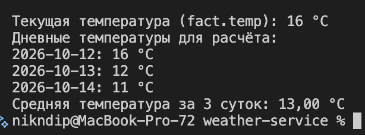

# Сервис получения метеорологических данных

Учебный проект на Java с использованием REST API Яндекс Погоды.

Программа:
- выполняет GET-запрос с координатами и заголовком X-Yandex-Weather-Key;
- выводит полный JSON-ответ без изменения содержимого;
- отдельно выводит текущую температуру из fact.temp;
- вычисляет среднее по forecasts[i].parts.day.temp_avg
  для первых limit дней прогноза.

В запросе используются координаты Москвы:
lat=55.75, lon=37.62, limit=3.

## Требования

- JDK 17 или новее
- Maven
- действующий ключ API Яндекс Погоды

## Запуск на macOS или Linux

Открой терминал bash или zsh в папке проекта.

Выполни команду, затем вставь свой API-ключ и нажми Enter.
Ввод ключа скрыт:

```bash
read -r -s YANDEX_WEATHER_KEY
```

Передай переменную программе:

```bash
export YANDEX_WEATHER_KEY
```

Собери проект и скачай зависимости:

```bash
mvn compile dependency:copy-dependencies
```

Запусти в том же терминале:

```bash
java -cp "target/classes:target/dependency/*" Main
```

Полный ответ дополнительно сохраняется в response.json.
При каждом успешном запросе файл обновляется.
Ключ API в репозитории не хранится.

## Пример результата

Для дневных температур 16, 12 и 11 °C:
средняя температура = (16 + 12 + 11) / 3 = 13 °C.

Фактические значения зависят от времени запроса.

